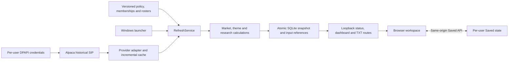

# Architecture

ThemeScope is a private loopback Python/FastAPI application with a vanilla
HTML/CSS/JavaScript UI. SQLite stores auditable observations, calculated results
and the active committed snapshot.

| Layer | Main paths | Contract |
| --- | --- | --- |
| Domain/config | `domain.py`, `config/vnext/` | Validated policy and effective-dated reviewed inputs |
| Providers | `providers/` | Historical bars/identity; no ThemeScope formulas or trading endpoints |
| Market | `market/`, `research_policy.py` | Separate SPY/QQQ breadth, frozen Market Matrix, IWM context |
| Calculations/history | `themes/`, `relative_performance.py` | Deterministic returns, index and compatible history |
| Research | `research/` | Independent relationships, eligibility, peer ordering and deterministic TXT |
| Persistence | `storage/` | Immutable data versions, run references and the committed snapshot pointer |
| Local application | `local/` | Startup, refresh coordination, guarded status and loopback API |
| UI | `static/vnext/` | Snapshot presentation; no browser financial-rule reconstruction |

See [provider/storage](provider-and-storage.md), [terminal actions](terminal-actions.md),
[methodology](../methodology/README.md), and [project map](../development/project-structure.md).
`vnext` identifiers remain stable for configuration, history, schema and Saved
compatibility. Earlier ETF dashboard code is preserved in Git history. Its data
and the current research series use separate formats.
